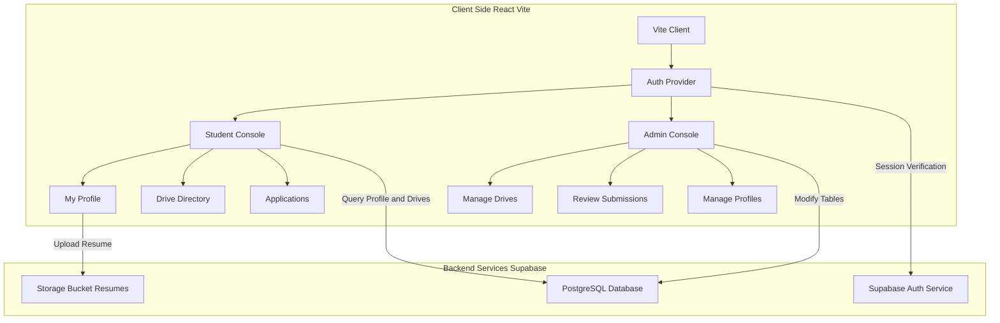

# 🎓 PlaceX: Campus Placement Management System

<div align="center">

[](https://github.com/FrostByte-49/PlaceX/stargazers)
[](https://github.com/FrostByte-49/PlaceX/blob/main/LICENSE)
[](https://www.typescriptlang.org/)
[](https://react.dev/)
[](https://supabase.com/)
[](https://github.com/FrostByte-49/PlaceX/issues)
[](https://github.com/FrostByte-49/PlaceX/pulls)

</div>

PlaceX is a next-generation web application designed to streamline, automate, and centralize the entire campus recruitment and placement lifecycle. Managing physical recruitment drives, tracking eligible student lists, reviewing resumes, and handling multiple application timelines often result in a chaotic paper trail and fragmented emails for educational institutions. PlaceX solves this core operational bottleneck by offering an integrated digital ecosystem where educational institutions, placement officers, and prospective student candidates can connect and collaborate seamlessly. By standardizing the communication flow, the application reduces the administrative burden on coordinators while boosting transparent career opportunities for eligible students.

From a technical standpoint, PlaceX is built on a highly modern, responsive stack using React 18, Vite, TypeScript, Tailwind CSS, and Supabase as its database and authentication engine. The platform is architected around granular, role-based access controls dividing client routes into administrative and student consoles. Key modules include real-time recruitment drive management, detailed student profiles featuring academic history tracking, an administrative application review system, and analytical dashboards displaying key placement stats. This robust architecture ensures rapid data loading, secure state management through custom React Hooks, and real-time database updates for dynamic application state synchronization.

<br>

## Table of Contents
- [Description](#-placex-full-cycle-campus-placement-automation--drive-management-system)
- [Features](#features)
- [Preview](#preview)
- [Tech Stack](#tech-stack)
- [System Architecture](#system-architecture)
- [Project Structure](#project-structure)
- [Installation](#installation)
- [Usage](#usage)
- [API Reference](#api-reference)
- [Customization](#customization)
- [Future Enhancements](#future-enhancements)
- [Contributing](#contributing)
- [License](#license)
- [Author](#author)
- [Support](#support)

<br>

## Features

* **Role-Based Access Control** – Strict page-level separation and secure client-side routing between student profiles and administrative dashboards.
* **Placement Drive Creation** – Administrative utilities to create, publish, and update active hiring drives, specifying cutoff criteria, packages, and eligibility.
* **Real-Time Dashboard Metrics** – Student and admin stats summarizing active drives, pending applications, selected candidates, and upcoming schedules.
* **Dynamic Student Profiles** – Customizable student portals to upload educational details, aggregate scores, and upload resumes for review.
* **Interactive Application Review** – Admin interface to screen candidates, accept or reject profiles, and track hiring stages in real-time.
* **Corporate Directory** – Centralized catalog of partner organizations, historical recruitment patterns, and company details.
* **Supabase PostgreSQL Database** – Dynamic data structures with foreign keys tracking student-application-drive associations flawlessly.

<br>

## Preview

| **Admin Portal Dashboard** | **Student Application Tracker** |
|:---:|:---:|
|  |  |

<br>

| **Drive Management Interface** | **Student Profile Builder** |
|:---:|:---:|
|  |  |

<br>

## Tech Stack

| Technology | Purpose |
|:---|:---|
| **React (v18)** | Client-side user interface rendering and declarative view architecture. |
| **Vite** | Ultra-fast development server, bundler, and module compiler. |
| **TypeScript** | Static typing layer ensuring runtime code safety and component contract integrity. |
| **Tailwind CSS** | Utility-first styling engine for rapid interface building and responsive views. |
| **Supabase Client SDK** | Direct client connectivity to PostgreSQL database and identity provider modules. |
| **Lucide React** | Scalable, performant vector icon library for interface elements. |
| **React Router (v6)** | Client-side routing engine managing application state across paths. |

<br>

## System Architecture



<br>

## Project Structure

```bash
PlaceX
├── .gitattributes                                    # Git attributes configuration file
├── PlaceX_                                           # Root folder containing frontend codebase
│   ├── .env.example                                  # Template for environment variables
│   ├── .gitignore                                    # Patterns to ignore in Git version control
│   ├── eslint.config.js                              # Linter configurations for code quality
│   ├── index.html                                    # Base HTML entry point for the Vite app
│   ├── package.json                                  # Project dependencies and script runner configurations
│   ├── tailwind.config.js                            # Utility-first CSS style specifications
│   ├── tsconfig.json                                 # Base TypeScript compilation rules
│   ├── tsconfig.app.json                             # Specific TypeScript compiler options for client app
│   ├── tsconfig.node.json                            # TypeScript configuration for build environments
│   ├── vercel.json                                   # Deployment configuration for Vercel edge runtime
│   ├── vite.config.ts                                # Build settings and plugin configurations for Vite
│   │
│   ├── 📁src/                                        # Application source codebase directory
│   │   ├── App.tsx                                   # Main core component routing orchestrator
│   │   ├── index.css                                 # Global styles and Tailwind directive injections
│   │   ├── main.tsx                                  # React entry mounting point inside DOM
│   │   │
│   │   ├── 📁components/                             # Reusable presentational components layout container
│   │   │   ├── 📁auth/                               # Authentication protection structures
│   │   │   │   └── ProtectedRoute.tsx                # High-order route guard to secure private endpoints
│   │   │   │
│   │   │   ├── 📁layout/                             # Frame scaffolding configurations
│   │   │   │   ├── Layout.tsx                        # Global application wrapper and template system
│   │   │   │   └── Sidebar.tsx                       # Context-aware navigation panel dashboard layout
│   │   │   │
│   │   ├── 📁context/                                # Global react context API files
│   │   │   └── AuthContext.tsx                       # React context provider managing user session state
│   │   │
│   │   ├── 📁hooks/                                  # Tailored custom functional hooks
│   │   │   └── useAuth.ts                            # Hook abstraction exposing authentication mechanisms
│   │   │
│   │   ├── 📁lib/                                    # Utilities, initializations, and schemas
│   │   │   ├── schema.sql                            # DDL statements for initializing Supabase PostgreSQL tables
│   │   │   ├── supabase.ts                           # Client client SDK configuration for Supabase API
│   │   │   └── utils.ts                              # Style merging and parsing general tools
│   │   │
│   │   ├── 📁pages/                                  # Primary routing components and screen layouts
│   │   │   ├── Login.tsx                             # Authentication screen targeting existing users
│   │   │   ├── Signup.tsx                            # Enrollment forms for student onboarding
│   │   │   │
│   │   │   ├── 📁admin/                              # Page modules restricted to platform administrators
│   │   │   │   ├── ManageCompanies.tsx               # Control panel for corporate listings management
│   │   │   │   ├── ManageDrives.tsx                  # Interactive planner for scheduling recruitment drives
│   │   │   │   ├── ManageStudents.tsx                # Directory interface to review student databases
│   │   │   │   └── ReviewApplications.tsx            # Moderation dashboard for candidate submissions
│   │   │   │
│   │   │   ├── 📁student/                            # Screen implementations customized for candidates
│   │   │   │   ├── Companies.tsx                     # View of active corporate partners
│   │   │   │   ├── Dashboard.tsx                     # Candidate primary landing workspace containing summaries
│   │   │   │   ├── DriveDetails.tsx                  # Detailed requirement sheets for individual campaigns
│   │   │   │   ├── Drives.tsx                        # Complete directory tracking upcoming hiring efforts
│   │   │   │   ├── MyApplications.tsx                # Trace panel tracking active application statuses
│   │   │   │   ├── Profile.tsx                       # Portfolio and educational record management console
│   │   │   │   └── Stats.tsx                         # Analytics interface visualizing success metrics
```

<br>

## Installation

### 1. Environmental Configurations
Create a local `.env` configuration file in the `PlaceX_` root folder. Copy the templates found in the example files to link your client codebase safely to your Supabase cloud back-end:

```bash
VITE_SUPABASE_URL=https://your-supabase-project.supabase.co
VITE_SUPABASE_ANON_KEY=your-supabase-anonymous-api-key-here
```

#

### 2. Set Up the Database Schema
Ensure database structures are in place. Log into your Supabase Workspace, navigate to the **SQL Editor**, copy the complete DDL instructions found in `PlaceX_/src/lib/schema.sql`, and execute them. This constructs all user profiles, tables, keys, and row-level security (RLS) policies needed for structural integration.

#

### 3. Install Package Dependencies
Install the node packages required for client routing, styling frameworks, icons, and components:

```bash
cd PlaceX_
npm install
```

#

### 4. Initiate Local Development Server
Launch the development environment to run and verify code updates interactively on your local host:

```bash
npm start
```

<br>

## Usage

PlaceX contains two workflows structured cleanly across different platform permissions.

### Student Career Flow
* **Creating Profiles:** Students compile their complete details (CGPA, active backlogs, links, and documents) to establish qualification validation.
* **Applying to Recruitment Drives:** Users locate live postings under the "Drives" panel, checking alignment against academic cutoffs instantly:

```typescript
// Sample implementation hook payload used by students to apply for dynamic drives
import { supabase } from '../lib/supabase';

export async function submitApplication(studentId: string, driveId: string, resumeUrl: string) {
  const { data, error } = await supabase
    .from('applications')
    .insert([
      { 
        student_id: studentId, 
        drive_id: driveId, 
        resume_url: resumeUrl, 
        status: 'Applied' 
      }
    ]);
  return { data, error };
}
```

### Admin Operations & Review Flow
* **Configuring Live Placement Drives:** Administrators establish upcoming drives, specifying parameters like target CGPAs and package structures.
* **Batch Reviewing Candidacies:** Placement coordinators sort, review, and change application states directly from their review deck:

```typescript
// Sample admin module to transition applications through placement pipelines
export async function updateApplicationStatus(applicationId: string, status: 'Selected' | 'Rejected' | 'Shortlisted') {
  const { data, error } = await supabase
    .from('applications')
    .update({ status: status })
    .eq('id', applicationId);
  return { data, error };
}
```

<br>

## API Reference

Because PlaceX communicates directly with a headless server ecosystem through the Supabase Client SDK, all operations map directly to relational queries on active PostgreSQL tables. Security is managed via PostgreSQL Row Level Security (RLS) policies.

### API Summary Table

| Method / Query | Table Destination | Description | Auth Required |
|:---|:---|:---|:---|
| `SELECT` | `profiles` | Retrieve profile metadata, academic indices, and roles. | Yes (User Identity) |
| `INSERT` | `profiles` | Instantiate student identity details on system registration. | Yes (User Identity) |
| `SELECT` | `companies` | Get active, historical recruiting organizations. | Yes (Authenticated) |
| `POST / UPDATE` | `drives` | Publish or change upcoming recruitment campaigns. | Yes (Admin-Only RLS) |
| `INSERT` | `applications` | Apply to a published drive tracking eligibility. | Yes (Student Role) |
| `UPDATE` | `applications` | Review and alter the status of active applications. | Yes (Admin-Only RLS) |

#

### 1) Fetching Eligible Placement Campaigns

Students pull published hiring timelines filtering out inactive or completed campaigns.

* **Payload Parameters / Schema Filters:**
```json
{
  "active_only": true,
  "min_cgpa_cutoff": 7.0
}
```

* **Client Invocation Response:**
```json
[
  {
    "id": "7c89a01d-92d3-4fbc-bde2-6e210188ef66",
    "title": "Software Engineer Intern 2025",
    "company_id": "aa109b8c-55b2-4d18-9ce0-f8fa79de6062",
    "package_lpa": 14.5,
    "cgpa_cutoff": 7.0,
    "last_date_to_apply": "2025-11-30T18:30:00Z",
    "is_active": true
  }
]
```
* **Notes:** Built-in client-side helpers run conditional evaluations using the verified profile CGPA to enforce registration permissions UI locks.

#

### 2) Admin Application Status Transitions

Admin panel changes applicant positions in processing lists.

* **Execution Payload Structure:**
```json
{
  "application_id": "fb210e19-9aa4-4c02-8f9f-cc7402aee089",
  "status": "Shortlisted"
}
```

* **Server State Mutation Return:**
```json
{
  "id": "fb210e19-9aa4-4c02-8f9f-cc7402aee089",
  "student_id": "89021b1a-2cc3-4b11-bb03-aa210d7e829a",
  "drive_id": "7c89a01d-92d3-4fbc-bde2-6e210188ef66",
  "status": "Shortlisted",
  "updated_at": "2025-10-14T09:22:11Z"
}
```
* **Notes:** Requires administrative credentials verified by the `profiles.role` DB field structure.

<br>

## Customization

* **Customize Academic Cutoff Logic** – Modify structural comparisons in `DriveDetails.tsx` to handle custom scale indices or non-traditional GPA models.
* **Adjust Resume Storage Buckets** – Re-route file destinations within `supabase.ts` storage settings to route assets to S3 buckets, local drives, or external document systems.
* **Integrate Custom SMTP for Notifications** – Set up transactional trigger emails inside the database to update students whenever their application status shifts.
* **Rebrand with Tailwind CSS Themes** – Adjust color definitions inside `tailwind.config.js` to align application interfaces with specific university or corporate branding.
* **Extend Dashboard Metrics Analytics** – Add SQL aggregation queries under custom hook systems inside `Stats.tsx` to calculate median salary, selection-to-rejection ratios, and company performance trends over time.

<br>

## Future Enhancements

* **Automated Resume Parsing using NLP** – Read uploaded PDFs directly using custom services to auto-populate profile forms and match skill sets to active listings.
* **Integrated Online Assessment Tooling** – Launch native test panels where companies can publish coding screens or dynamic MCQ evaluations inside the portal.
* **Native Video Interview Modules** – Build WebRTC interview integrations directly into application panels so coordinators do not have to leverage third-party tools.
* **Placement Officer Slack/Discord Alerts** – Trigger automated push webhooks notifying channels when registration quotas close or shortlists drop.
* **Historical Placement Analytics Modeling** – Build visual models modeling placement probability, tracking application trajectories across graduation cohorts.
* **Digital Document Verification via Blockchain** – Store student academic score proofs on distributed verification layers to secure academic records from potential forgery.

<br>

## Contributing

### How To Contribute

To maintain source reliability, follow these structural deployment routines:


1. **Fork the Repository**  
   Create a unique branch under your target account to house updates and isolated additions.

#

2. **Clone and Branch Structurally**  
   Bring updates down to your workspace environment and configure a specialized working branch:

   ```bash
   git clone https://github.com/FrostByte-49/PlaceX.git
   cd PlaceX
   git checkout -b feature/your-proposed-change
   ```

#

3. **Verify Lints and Builds**  
   Make sure code formatting remains clean and correct relative to project rules before filing issues:

   ```bash
   npm run lint
   ```

#

4. **Commit Declaratively**  
   Package changes using precise commits following conventional changelog descriptions:

   ```bash
   git commit -m "feat: implement resume parsing eligibility locks"
   ```

#

5. **Initiate Verification Pull Requests**  
   Push changes to your remote fork and initiate an official review request mapping out the functional adjustments.

#

### Areas For Contribution
* User Experience and Accessibility optimization across different device screens.
* Writing modular test suites using Vitest or React Testing Library.
* Integrating real-time notification streams.
* Constructing CSV/XLSX generation pipelines for admin analytics records.

<br>

## License

This project is licensed under the MIT License. See the [LICENSE](https://github.com/FrostByte-49/PlaceX/blob/main/LICENSE) file for details.

<br>

## Author

**FrostByte-49**<br><br>
[](https://github.com/FrostByte-49) &nbsp;

<br>

## 🌟 Support The Project

If PlaceX made coordinate tasks simpler, help make the project more visible to developers around the world:
- Star the repository to boost visibility.
- Share your thoughts and propose improvements on our Issues board.
- Mention our efforts to fellow developers and academic coordinators!

<br>

<!-- Minimal Documentation Badge -->
<p align="right">
  <a href="https://trywharf.vercel.app/" target="_blank">
    
  </a>
</p>
